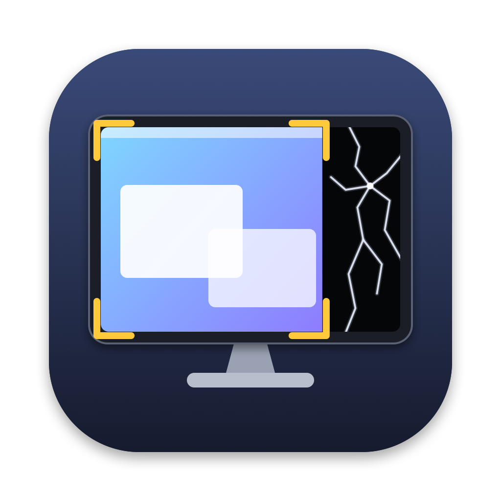

<p align="center">
  
</p>

<h1 align="center">ScreenCrop</h1>

<p align="center">Use only the working part of a damaged MacBook screen.</p>

ScreenCrop creates a virtual display that is the size of the working area and
makes it the main display. It streams that display, pixel for pixel, into the
top-left corner of the built-in screen and paints the rest black. The cursor
stays on the virtual display.

ScreenCrop runs only while the built-in screen is the only display. When an
external display connects, ScreenCrop pauses. When the external display
disconnects, ScreenCrop starts again.

## Install

1. Download `ScreenCrop-vX.Y.Z.zip` from the
   [latest release](https://github.com/sponrad/screencrop/releases/latest).
2. Unzip it, and move `ScreenCrop.app` to `/Applications`.
3. Open the app. The release has no Apple Developer ID signature, so macOS
   blocks it the first time. Go to System Settings > Privacy & Security, and
   click **Open Anyway** next to the ScreenCrop message. You can also clear
   the download flag from a terminal:

   ```bash
   xattr -dr com.apple.quarantine /Applications/ScreenCrop.app
   ```

## Build and run

```bash
./build.sh
open build/ScreenCrop.app
```

The build is a universal app for Apple silicon and Intel Macs.

## Release

Push a version tag. The `Release` workflow builds the app and attaches a zip
to a new GitHub release.

```bash
git tag v0.1.0
git push origin v0.1.0
```

For a safe trial, quit after a set number of seconds:

```bash
open build/ScreenCrop.app --args --for 60
```

## Permissions

ScreenCrop needs two permissions. Grant both in System Settings > Privacy &
Security:

- **Screen & System Audio Recording**, to capture the virtual display.
- **Accessibility**, to move windows into the visible area.

If a permission is missing, the crop stays off. After you grant both, quit the
app and open it again.

### Keep permissions across rebuilds

macOS ties the permissions to the app's signature. An ad-hoc signature changes
on each build, so macOS asks again after each rebuild. A local signing
certificate stops this. `build.sh` uses it when the keychain has it.

1. Open Keychain Access.
2. Select Keychain Access > Certificate Assistant > Create a Certificate.
3. Set the name to `ScreenCrop Local Signing`.
4. Set Identity Type to Self Signed Root.
5. Set Certificate Type to Code Signing.
6. Click Create.
7. Run `./build.sh` again, and grant the permissions one more time.

## Use

- Press ⌃⌥⌘C to turn the crop on or off.
- The ◧ menu bar item shows the state and has Quit.
- When the crop starts, ScreenCrop moves the windows on the built-in screen
  into the visible area. Full-screen windows stay where they are. To move the
  windows again, click Gather Windows in the ◧ menu.
- The ◧ menu sets the capture frame rate, 60 or 30 fps. 30 fps saves a little
  GPU work. The virtual display stays at 60 Hz, so games keep full speed.
- If ScreenCrop quits or crashes, macOS removes the virtual display and the
  normal screen comes back.

## Settings

The working area is given in points and starts at the top-left corner. The
default is 1300 × 982, which is the left part of a 14-inch MacBook Pro screen
at its default resolution. Keep the built-in screen at that default
resolution.

```bash
defaults write com.sponrad.ScreenCrop width -int 1300
defaults write com.sponrad.ScreenCrop height -int 982
```

## How it works

- `CGVirtualDisplay`, a private CoreGraphics API, creates the virtual display
  with a HiDPI mode.
- ScreenCaptureKit captures that display. Each frame goes onto a layer in a
  borderless window on the built-in screen.
- The virtual display sits at the origin, so it is the main display. The
  built-in screen touches it only at a corner, and a mouse event monitor moves
  the cursor back if it reaches the built-in screen.
- The Accessibility API moves other apps' windows from the built-in screen to
  the virtual display.

While the crop runs, WindowServer uses about 3% more of one CPU core on an
idle desktop and about 38% more during a full-screen game. See
[benchmarks](docs/benchmarks.md) for the measurements, and
[alternatives](docs/alternatives.md) for the other approaches that were tried.

## License

MIT. See [LICENSE](LICENSE).
